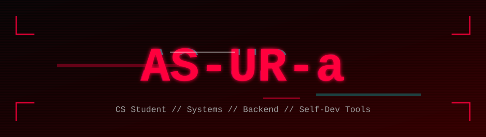

  

 

  <code>systems programming · backend architecture · distributed systems · cryptography</code>

 

<h2 align="center">// ABOUT //</h2>

  <i>
    not a geek, just guy from village. vVv
  </i>

 

<h2 align="center">// STACK //</h2>

  
  
  
  

  
  
  

  
  

 

<h2 align="center">// ACTIVE //</h2>

  

 

<h2 align="center">// PROJECTS //</h2>

  

  <code>account-based · c++20 · ed25519 · sha256 · proof-of-work · mempool · state · merkle</code>

 

<h2 align="center">// STATS //</h2>

  
  

  

 

<h2 align="center">// SOCIAL //</h2>

  
  

 

  

